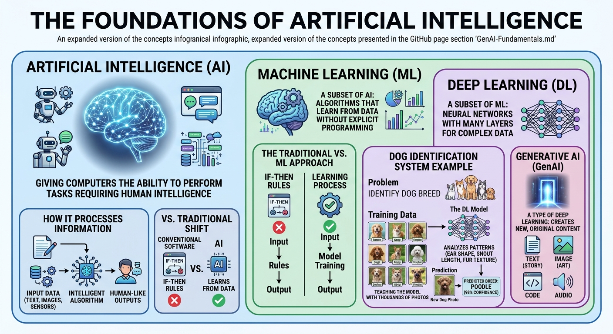
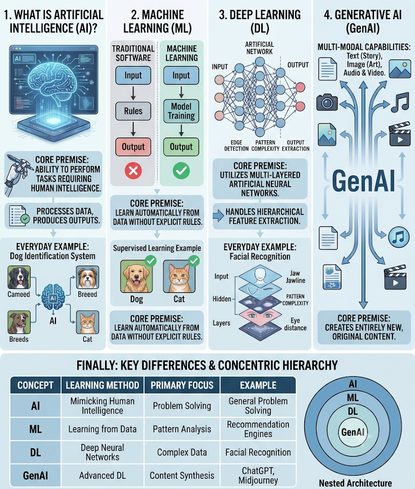

# Generative-AI:

## **Basic Understanding:**

  

   
## **Detailed Understanding:**

  

### **Foundations of Artificial Intelligence:**   
 
 - **Core Definition:** AI is the foundational science of giving computers and machines the ability to perform tasks that typically require human intelligence.
 - **Information Processing:** AI systems take input data (like text, images, or sensors), process it through intelligent algorithms, and generate human-like outputs.
 - **Traditional Shift:** Unlike conventional software relying on rigid "If-Then" rules, AI systems dynamically learn from data.
 - **Machine Learning Subset:** ML is a core branch where algorithms learn patterns automatically from data without explicit manual programming.
 - **Deep Learning Layer:** DL uses multi-layered neural networks to analyze complex data like images.
 - **Practical Example:** The image illustrates a Dog Identification System, where a deep learning model analyzes training photos based on features like ear shape and fur texture.
 - **Prediction:** After training, the model successfully identifies and predicts new dog breeds with high confidence (e.g., classifying a poodle).
 - **Generative AI (GenAI):** Positioned within deep learning, GenAI goes beyond analysis to synthesize brand-new content such as text, images, code, and audio.
 - **Multi-Modal Capabilities:** GenAI models can generate a wide range of original digital formats, including text, art/images, audio, and video.

## Summary:

